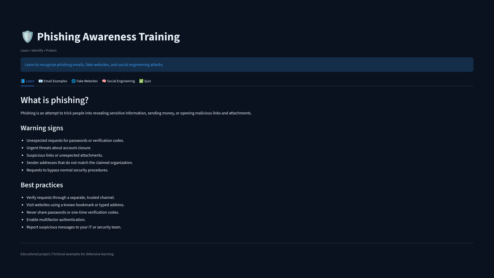

# 🛡️ Phishing Awareness Training

An interactive cybersecurity awareness application built with Python and Streamlit to educate users about phishing attacks, fraudulent websites, and social engineering techniques.

[](https://github.com/charansaiteja-cloud/CodeAlpha_PhishingAwarenessTraining/actions/workflows/tests.yml)

**Author:** Bejjam Charan Sai Teja  
**License:** MIT  
**Project Type:** Cybersecurity Awareness and Education

---

## 📌 Project Overview

Phishing is a cyberattack in which attackers impersonate trusted organizations or individuals to trick users into revealing sensitive information, transferring money, or opening malicious links and attachments.

This project provides an interactive learning environment that helps users recognize common phishing indicators, understand attacker tactics, and practice safer online behavior.

## ✨ Features

- 📘 **Phishing Fundamentals** — Learn how phishing attacks work.
- 📧 **Email Analysis** — Understand suspicious senders, urgent requests, and malicious links.
- 🌐 **Fake Website Awareness** — Identify suspicious domains and fraudulent login pages.
- 🧠 **Social Engineering** — Learn about impersonation, urgency, fear, and manipulation.
- ✅ **Interactive Quiz** — Answer five scenario-based questions and review explanations.
- 📊 **Session Score Tracking** — Results, per-question feedback and downloads persist for the browser session.
- 🏆 **Completion Certificate** — At 80% or higher, download a printable HTML certificate with your name, date, score and reference.
- 📄 **Detailed Quiz Report** — Download a text report showing every question, your selection, the correct answer and the explanation.

## Project Demo

A 2-minute narrated walkthrough of the application is included in this repository. It shows the real Streamlit interface and the training flow end to end.



- **Video:** [`demo/phishing_awareness_demo.mp4`](demo/phishing_awareness_demo.mp4) — 1920×1080, 30 fps, 120 seconds, H.264/AAC, with captions.
- **Demonstrated features:**
  - **Learn** — phishing fundamentals, warning signs and best practices.
  - **Email Examples** — sender, subject and link red flags, plus the safe response.
  - **Fake Websites** — suspicious domains, and why HTTPS alone is not proof of trust.
  - **Social Engineering** — authority, urgency, fear, curiosity, familiarity and baiting.
  - **Quiz** — answer selection, score, and the completion certificate and quiz report actions.

To watch it, open the video link above and use GitHub's **Download raw file** button (or **View raw**), then play the MP4 in any standard video player. After cloning the repository, the file is available locally at `demo/phishing_awareness_demo.mp4`.

## 🛠️ Technologies Used

- Python 3.10+
- Streamlit
- pytest and Streamlit `AppTest`
- Git, GitHub and GitHub Actions

## 📂 Project Structure

```text
Phishing-Awareness-Training/
├── app.py                     # Streamlit entry point and UI
├── quiz.py                    # Quiz data, scoring, report and certificate builders
├── requirements.txt           # Runtime dependency
├── requirements-dev.txt       # Test dependencies
├── pytest.ini
├── .streamlit/
│   └── config.toml            # Dark theme used by the app and demo
├── tests/
│   ├── test_app.py            # Streamlit AppTest end-to-end checks
│   └── test_quiz.py           # Scoring and document-generation unit tests
├── .github/
│   └── workflows/tests.yml    # CI test workflow
├── demo/
│   └── phishing_awareness_demo.mp4
├── docs/
│   └── app-preview.jpg
├── README.md
├── LICENSE
└── .gitignore
```

The local `.venv/` and `output/` demo build artifacts are intentionally not tracked.

## ⚙️ Installation and Setup

### Prerequisites

Install Python 3.10 or newer and ensure that Python and pip are available from your terminal.

Verify your installation:

```bash
python --version
python -m pip --version
```

### 🐧 Linux Installation (Kali Linux, Ubuntu, Debian)

**1. Install Python and virtual environment support**

On Debian-based systems:

```bash
sudo apt update
sudo apt install python3 python3-venv python3-pip
```

**2. Navigate to the project directory**

```bash
cd ~/Phishing-Awareness-Training
```

**3. Create a virtual environment**

```bash
python3 -m venv .venv
```

**4. Activate the environment**

```bash
source .venv/bin/activate
```

**5. Install dependencies**

```bash
python -m pip install --upgrade pip
python -m pip install -r requirements.txt
```

**6. Check the application syntax**

```bash
python -m py_compile app.py quiz.py
```

No output indicates that the syntax check passed.

**7. Start the application**

```bash
streamlit run app.py
```

### 🪟 Windows Installation

**1. Install Python**

Download Python from:

https://www.python.org/downloads/windows/

During installation, enable **Add Python to PATH**.

**2. Open PowerShell**

Navigate to the folder containing the project:

```powershell
cd "$HOME\Phishing-Awareness-Training"
```

If you have not downloaded or copied the project yet, first obtain the project files and navigate to their location.

**3. Create a virtual environment**

```powershell
py -m venv .venv
```

**4. Activate the environment**

```powershell
.\.venv\Scripts\Activate.ps1
```

If PowerShell blocks activation, you can use Command Prompt instead:

```bat
.venv\Scripts\activate.bat
```

**5. Install dependencies**

```powershell
python -m pip install --upgrade pip
python -m pip install -r requirements.txt
```

**6. Check the application syntax**

```powershell
python -m py_compile app.py quiz.py
```

**7. Start the application**

```powershell
python -m streamlit run app.py
```

## 🧪 Testing

Install the development dependencies and run the suite from the repository root:

```bash
python -m pip install -r requirements-dev.txt
python -m pytest -q
```

The tests use Streamlit's `AppTest` harness and cover:

- scoring and the 80% pass threshold,
- unanswered-question validation,
- result persistence across reruns,
- retry and reset behavior,
- certificate/report generation, including HTML escaping.

The same checks run in GitHub Actions on every push and pull request: [`.github/workflows/tests.yml`](.github/workflows/tests.yml).

## ☁️ Deployment

The project can be deployed to Streamlit Community Cloud:

1. Point the app at `app.py`.
2. Keep `requirements.txt` in the repository so dependencies are installed.
3. Deploy. `.streamlit/config.toml` supplies the dark theme automatically.

No secrets, external APIs or databases are required.

## 🚀 How to Use the Application

**Step 1 — Launch the application**

Run the Streamlit command for your operating system.

**Step 2 — Open the dashboard**

Streamlit normally displays a local URL:

http://localhost:8501

Open this address in your web browser.

**Step 3 — Study the learning module**

Read the introductory material to understand phishing and its common warning signs.

**Step 4 — Explore email examples**

Examine suspicious sender addresses, unexpected attachments, urgent messages, and unusual requests.

**Step 5 — Learn about fake websites**

Review suspicious domain names, misleading URLs, and fraudulent login pages. Remember that HTTPS alone does not prove a website is trustworthy.

**Step 6 — Study social engineering**

Learn how attackers exploit trust, authority, fear, curiosity, and urgency.

**Step 7 — Complete the quiz**

Open the quiz section, optionally enter your name for the certificate, answer all five questions, and submit. Results and downloads remain available for the session. A score of 80% or higher unlocks the certificate.

**Step 8 — Download your results**

Download the detailed quiz report after any submission, or the HTML completion certificate when you score 80% or higher.

**Step 9 — Stop the application**

Return to the terminal running Streamlit and press:

```text
Ctrl + C
```

## 🔄 Application Workflow

```text
Start
  |
  v
Launch Streamlit Application
  |
  v
Open Dashboard in Browser
  |
  v
Study Phishing Awareness Topics
  |
  v
Explore Email and Website Examples
  |
  v
Learn Social Engineering Techniques
  |
  v
Complete Interactive Quiz
  |
  v
Review Score and Explanations
  |
  v
Download Available Report or Certificate
  |
  v
End
```

## 🔐 Security Best Practices

- Verify the sender before responding to unexpected messages.
- Do not share passwords or one-time verification codes.
- Avoid opening unexpected attachments or suspicious links.
- Visit sensitive websites using a known bookmark or a manually entered trusted address.
- Verify payment and account-change requests through a separate trusted channel.
- Enable multifactor authentication.
- Report suspected phishing to the relevant security team.
- Never use real credentials in training demonstrations.

## 🎯 Learning Outcomes

After completing the training, users should be better able to:

- Recognize common phishing indicators.
- Identify suspicious URLs and fraudulent websites.
- Understand common social engineering techniques.
- Respond safely to suspicious communications.
- Apply practical cybersecurity hygiene.

## 📌 Limitations

- The certificate is an educational completion record, not an independently verified credential.
- Progress is stored per browser session; there are no user accounts or long-term score history.
- Training content is currently English-only and delivered as static guidance plus a knowledge check.

## ⚠️ Disclaimer

This project is intended for cybersecurity awareness, education, and defensive learning.

All examples should be fictional or appropriately sanitized. Do not use this project to collect credentials, impersonate real organizations, or conduct unauthorized security testing.

## 📜 License

This project is licensed under the MIT License. See the `LICENSE` file for details.

## 👨‍💻 Author

**Bejjam Charan Sai Teja**

Phishing Awareness Training — Cybersecurity Education Project.
