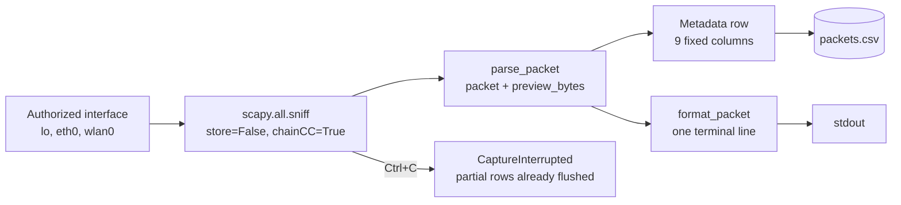

# Basic Network Sniffer

**A metadata-first, privacy-conscious packet sniffer for networks you are authorized to monitor.**

[](https://www.python.org/)
[](https://scapy.net/)
[](#testing)
[](LICENSE)
[](#about)

---

## Demo

**[▶ Watch the demo video (MP4, 53 s)](basic-network-sniffer-demo.mp4)** — a real capture of the
tool running against a loopback interface: the live terminal output, the protocol decoding, the nine-column
CSV, and the ICMP-only payload guard rail.

The file is committed at the repository root as `basic-network-sniffer-demo.mp4`
(1920×1080, H.264 + AAC stereo, 53.5 s).

---

## Introduction

`sniffer.py` is a single-file command-line packet sniffer built on [Scapy](https://scapy.net/). It captures
frames from an interface you own or have written permission to test, decodes them into a stable metadata
row, prints one readable line per packet, and writes the same rows to a nine-column CSV file.

The design goal is deliberately narrow: **record the metadata, not the payload.** TCP, UDP and DNS payloads
are never written to disk or printed. The only payload bytes the tool can emit are an optional, opt-in
prefix of an ICMP/ICMPv6 message, hard-capped at 16 bytes and disabled by default.


**Author:** Bejjam Charan Sai Teja

---

## Features

- Captures from any interface Scapy can see, selected with `-i`.
- Bounded capture (`-c N`) or continuous capture until you stop it with `Ctrl+C`.
- Identifies **IPv4, IPv6, ARP, TCP, UDP, ICMP, ICMPv6 and DNS** when Scapy decodes them.
- Prints one formatted line per packet: UTC timestamp, protocol stack, source → destination, ports, length.
- Exports every captured packet to a fixed nine-column CSV, flushed after each row.
- Payload previews are **off by default** and, when enabled, restricted to a 16-byte ICMP/ICMPv6 prefix.
- Streams packets without buffering them in memory (`store=False`), so long captures stay flat in memory.
- Validates the interface, the packet count and the preview size before touching the network.
- Ships with an offline pytest suite that builds synthetic packets — no live capture required to run tests.

---

## Supported protocols

| Layer  | Protocols detected | Notes |
| ------ | ------------------ | ----- |
| Network | IPv4, IPv6, ARP | Source/destination are taken from the IP or ARP header. |
| Transport | TCP, UDP | Source and destination ports are recorded when present. |
| Message | ICMP, ICMPv6 | Detected via Scapy's concrete ICMPv6 classes; the only layer eligible for a payload prefix. |
| Application | DNS | Recorded when Scapy dissects the UDP payload as DNS. |

Packets that match none of the above are recorded with the protocol stack `OTHER`.

---

## Architecture

The tool is a single module with one data flow: **capture → parse → record**.



1. **Capture** — `capture_to_csv()` resolves the interface against `available_interfaces()`, then hands the
   socket to Scapy's `sniff()` with `store=False`, so frames are processed and dropped instead of accumulated.
   `chainCC=True` makes `Ctrl+C` reach the tool's own handler instead of being swallowed by Scapy.
2. **Parse** — `parse_packet()` walks the layer stack once and produces a plain `dict` with exactly the nine
   columns in `CSV_COLUMNS`. It never touches TCP/UDP/DNS payload bytes.
3. **Record** — the row is written with `csv.DictWriter` and flushed immediately, so an interrupted capture
   still leaves a valid, complete-prefix CSV on disk. The same row is formatted by `format_packet()` for
   terminal output.

The parsing and CSV layers are pure functions over packet objects, which is what makes the offline test
suite possible.

---

## Project structure

```
.
├── basic-network-sniffer-demo.mp4   # Demo recording (MP4, 1920x1080)
├── LICENSE                           # MIT License
├── README.md                         # This file
├── requirements.txt                  # Pinned dependency ranges
├── sniffer.py                        # Capture, parsing and CSV export
└── tests/
    └── test_sniffer.py               # Offline pytest suite (synthetic packets)
```

---

## Prerequisites

| Requirement | Version | Notes |
| ----------- | ------- | ----- |
| Python | 3.9 or newer | Verified on CPython 3.14.8. The source parses cleanly against the 3.9 grammar. |
| Scapy | `>= 2.6.1, < 3.0` | Verified with 2.8.0. |
| pytest | `>= 8.0, < 10.0` | Verified with 9.1.1. Only needed to run the test suite. |
| Capture privileges | — | `CAP_NET_RAW` on Linux, Administrator + Npcap on Windows. |

The tool itself depends only on the Python standard library plus Scapy. `pytest` is listed in
`requirements.txt` for convenience but is only needed to run the test suite.

---

## Installation

Clone the repository and enter the project directory:

```bash
git clone https://github.com/charansaiteja-cloud/CodeAlpha_BasicNetworkSniffer.git
cd CodeAlpha_BasicNetworkSniffer
```

### Kali Linux

```bash
sudo apt update
sudo apt install -y python3 python3-venv python3-pip git

python3 -m venv .venv
source .venv/bin/activate
python -m pip install --upgrade pip
python -m pip install -r requirements.txt
```

### Debian / Ubuntu

```bash
sudo apt update
sudo apt install -y python3 python3-venv python3-pip git

python3 -m venv .venv
source .venv/bin/activate
python -m pip install --upgrade pip
python -m pip install -r requirements.txt
```

On Linux, packet capture needs raw-socket privileges. Either grant them to your account or run the tool
with an approved least-privilege method:

```bash
# Option A: one-off elevation (run from the project directory)
sudo "$PWD/.venv/bin/python" sniffer.py -i lo -c 5 -o demo.csv
```

> `sudo` will create output files owned by `root`. Prefer the unprivileged path when your account already
> has capture rights.

### Windows (PowerShell)

Packet capture on Windows requires [Npcap](https://npcap.com/) (the successor to WinPcap) and an
elevated shell. Scapy uses Npcap's `NPF` devices for live capture on Windows.

```powershell
# 1. Install Python 3 (skip if already installed)
winget install --id Python.Python.3.12 -e

# 2. Install Npcap from https://npcap.com/ - check "Install Npcap in WinPcap API-compatible mode"
#    (install it BEFORE running the capture commands)

# 3. Clone and enter the project directory
git clone https://github.com/charansaiteja-cloud/CodeAlpha_BasicNetworkSniffer.git
Set-Location CodeAlpha_BasicNetworkSniffer

# 4. Create and activate a virtual environment
py -3 -m venv .venv
.\.venv\Scripts\Activate.ps1
python -m pip install --upgrade pip
python -m pip install -r requirements.txt

# 5. List the interfaces Scapy can see (run this from an Administrator PowerShell)
python sniffer.py --list-interfaces

# 6. Capture (run this from an Administrator PowerShell)
python sniffer.py -i "Wi-Fi" -c 20 -o demo.csv
```

If PowerShell refuses to run the activation script, allow it for the current session only:

```powershell
Set-ExecutionPolicy -Scope Process -ExecutionPolicy Bypass
```

Windows interface names are the adapter friendly names reported by `--list-interfaces` (for example
`Wi-Fi` or `Ethernet`). Quote names that contain spaces.

---

## Usage

### List the available interfaces

```bash
python sniffer.py --list-interfaces
```

```
br-22b23fcad2ba
docker0
eth0
lo
tailscale0
wlan0
```

(The list is abridged here; run the command to see every interface Scapy detects on your machine.)

You can cross-check the list against the operating system:

```bash
ip -brief link      # Linux
ip -brief address
ip route
```

### Capture a bounded number of packets

```bash
python sniffer.py -i lo -c 5 -o demo.csv
```

```
Interface: lo
Packet limit: 5
CSV output: demo.csv
ICMP preview: 0 byte(s)
Monitoring authorized traffic only. Press Ctrl+C to stop.
2026-10-22T12:25:02.289+00:00 | IPv4/TCP | 127.0.0.1 -> 127.0.0.1 (60570 -> 34463) | 74 bytes
2026-10-22T12:25:02.290+00:00 | IPv4/ICMP | 127.0.0.1 -> 127.0.0.1 | 81 bytes
Capture finished. Packets recorded: 5
CSV saved to: demo.csv
```

Replace `lo` with an interface you are authorized to monitor, for example `wlan0` or `eth0`.

### Capture continuously and stop with Ctrl+C

```bash
python sniffer.py -i wlan0 -c 0 -o demo.csv
```

`-c 0` means unlimited. Press `Ctrl+C` to stop; the rows captured so far are already flushed to the CSV
and the process exits with status `130`:

```
Capture interrupted after 68 packet(s). CSV saved to: demo.csv
```

### Enable the optional ICMP payload prefix

```bash
python sniffer.py -i lo -c 10 --hex-preview 8 -o demo.csv
```

`--hex-preview` accepts 1–16 bytes and applies **only** to ICMP and ICMPv6 messages. TCP, UDP and DNS
payloads are never previewed, and the column stays empty for those rows.

```
2026-10-22T12:25:02.290+00:00 | IPv4/ICMP | 127.0.0.1 -> 127.0.0.1 | 81 bytes | ICMP payload prefix: 45000027e78b4000
```

### Export to CSV

The CSV path is set with `-o` and defaults to `packets.csv`:

```bash
python sniffer.py -i lo -c 100 -o captures/session-01.csv
```

The parent directory must already exist; the tool does not create it.

### Use it as a library

```python
from scapy.all import Ether, IP, TCP

import sniffer

packet = Ether() / IP(src="192.0.2.1", dst="198.51.100.2") / TCP(sport=1234, dport=443)

row = sniffer.parse_packet(packet)
print(row["protocols"])                       # 'IPv4/TCP'
print(row["src"], "->", row["dst"])          # '192.0.2.1 -> 198.51.100.2'

sniffer.write_packets_csv("out.csv", [packet])   # offline CSV export
sniffer.available_interfaces()                  # ['eth0', 'lo', ...]
```

---

## CSV output format

Every capture writes the same nine columns, in this order.

| Column | Type | Description |
| ------ | ---- | ----------- |
| `timestamp` | string | Capture time in ISO-8601 UTC with millisecond precision, e.g. `2026-10-22T12:25:02.289+00:00`. |
| `src` | string | Source address: IPv4/IPv6 address, or the ARP sender protocol address. Empty when the frame has no network layer. |
| `dst` | string | Destination address: IPv4/IPv6 address, or the ARP target protocol address. Empty when the frame has no network layer. |
| `src_port` | string | Source transport port for TCP/UDP. Empty otherwise. |
| `dst_port` | string | Destination transport port for TCP/UDP. Empty otherwise. |
| `ip_version` | string | `IPv4`, `IPv6`, or empty for non-IP frames such as ARP. |
| `protocols` | string | The decoded layer stack joined with `/`, for example `IPv4/TCP`, `IPv4/UDP/DNS`, `IPv4/ICMP`, `ARP`, or `OTHER`. |
| `length` | integer | Total captured frame length in bytes. |
| `hex_preview` | string | Hex-encoded ICMP/ICMPv6 payload prefix, at most 16 bytes. Empty unless `--hex-preview` is enabled, and always empty for TCP/UDP/DNS. |

### Illustrative output

The rows below are representative of a loopback capture and are shown for illustration only.

```csv
timestamp,src,dst,src_port,dst_port,ip_version,protocols,length,hex_preview
2026-10-22T12:25:02.289+00:00,127.0.0.1,127.0.0.1,60570,34463,IPv4,IPv4/TCP,74,
2026-10-22T12:25:02.289+00:00,127.0.0.1,127.0.0.1,34463,60570,IPv4,IPv4/TCP,74,
2026-10-22T12:25:02.290+00:00,127.0.0.1,127.0.0.1,,,IPv4,IPv4/UDP,53,
2026-10-22T12:25:02.290+00:00,127.0.0.1,127.0.0.1,,,IPv4,IPv4/ICMP,81,45000027e78b4000
```

---

### Filtering with BPF

Keep the capture small and privacy-preserving by filtering in libpcap before a
packet reaches Python:

```bash
python sniffer.py -i eth0 --bpf "tcp port 443" -c 100 -o https.csv
python sniffer.py -i wlan0 --bpf "icmp or arp" -c 50
```

An invalid or empty filter is rejected before capture starts.

## Testing

The test suite is fully offline: it builds synthetic Scapy packets and never opens a capture socket.

```bash
source .venv/bin/activate
python -m py_compile sniffer.py tests/test_sniffer.py
python -m pytest -v
```

---

## Verification

The checks below were actually executed against this repository on 2026-10-22, on Linux with
CPython 3.14.8 in the project virtual environment.

| Check | Command | Result |
| ----- | ------- | ------ |
| Byte-compilation | `python -m py_compile sniffer.py tests/test_sniffer.py` | Passed |
| Test suite | `python -m pytest -v` | **16 passed**, 0 failed |
| Dependency and import check | `import scapy, pytest, sniffer` | Passed — Scapy 2.8.0, pytest 9.1.1 |
| Interface discovery | `python sniffer.py --list-interfaces` | Passed — 11 interfaces listed, exit code 0 |
| Live bounded capture | `python sniffer.py -i lo -c 25 -o live_capture.csv` | Passed — 25 packets captured, 25 CSV data rows written |
| Live continuous capture with `Ctrl+C` | `python sniffer.py -i lo -c 0` then `SIGINT` | Passed — "Capture interrupted after 68 packet(s)", exit code 130, 68 CSV data rows written |
| Invalid interface handling | `python sniffer.py -i does-not-exist -c 5` | Passed — clear error listing the available interfaces, exit code 1 |
| Insufficient privileges | `python sniffer.py -i lo -c 3` as an unprivileged user | Passed — "Permission denied" message, exit code 1 |
| Demo media integrity | `ffprobe -v error -show_entries format=duration -show_entries stream=codec_type,width,height basic-network-sniffer-demo.mp4` | Passed — MP4, H.264 1920×1080 @ 30 fps, AAC 48 kHz stereo, 53.5 s, 11,426,632 bytes |
| README link and anchor check | Relative links and heading anchors resolved against the working tree | Passed — no broken links |

The live captures were performed on the loopback interface of an isolated network namespace, so the
traffic was self-generated and no external host was observed.

---

## Troubleshooting

**`Permission denied. Check capture permissions for your interface and output directory.`**
Live capture needs raw-socket privileges. On Linux, run with `sudo` (or grant `CAP_NET_RAW` to your
account). On Windows, run the PowerShell session as Administrator and make sure Npcap is installed.

**`Capture error: Interface 'wlan0' was not found. Available: ...`**
The interface name does not match what Scapy sees. Run `python sniffer.py --list-interfaces` and use a name
from that list. On Windows, quote friendly names that contain spaces.

**`Capture error: [Errno 100] Network is down`**
The interface exists but is down. Bring it up first (`sudo ip link set lo up`) or choose an active interface.

**No packets are captured.**
The interface may be idle, or the traffic may be on a different interface than the one you selected. Try
`lo` while generating local traffic, or use `ip route` to find the interface that carries your traffic.

**`PermissionError` when writing the CSV.**
The output directory is not writable by the current user — a common case after a previous `sudo` run
created root-owned files. Write to a new path or fix the ownership.

**DNS rows do not appear.**
DNS is identified only when Scapy dissects the UDP payload as DNS. Encrypted or malformed payloads will be
recorded as `IPv4/UDP`.

---

## Security and privacy

- **Only monitor networks you own or have explicit written permission to assess.** Unauthorized interception
  is illegal in most jurisdictions.
- Captured metadata (addresses, ports, timestamps, protocol stacks) is still sensitive: it reveals who
  talked to whom and when. Treat the CSV as confidential.
- Payload previews are off by default and, when enabled, are limited to 16 bytes of ICMP/ICMPv6 data.
  For echo request/reply messages, the ICMP payload is the quoted original IP header — enabling the preview
  can therefore expose addresses of unrelated hosts.
- Never commit real captures. The repository's `.gitignore` already excludes `*.pcap`, `*.pcapng`,
  `packets.csv`, `demo.csv`, `captures/`, `*.log` and `.env` files.
- The tool has no authentication, no encryption and no access control: anyone who can read the output file
  can read the capture.

---

## Limitations

- Live capture was verified on **Linux only**. The Windows instructions above are derived from the
  implementation — the source uses only the standard library plus Scapy and contains no POSIX-specific calls —
  and from Scapy's documented Npcap requirement, but they were **not executed on Windows** in this
  environment.
- Capture requires elevated privileges; the tool never elevates them itself.
- BPF filters are supported with `--bpf`, but the default records every frame on the selected
  interface. Pass a filter when you only need one protocol or port. Filter upstream
  (for example with `tcpdump`) when you need to narrow the capture.
- On Linux, the loopback interface reports each frame twice — a known kernel behaviour, not a parsing bug.
  It was observed during verification (see the live capture above).
- The tool records metadata only. It does not reassemble TCP streams, decrypt TLS, or store payloads.
- Every row is flushed to disk individually, which keeps captures crash-safe but is I/O heavy at very high
  packet rates.
- Protocol identification relies entirely on Scapy's dissectors; unusual or deliberately malformed traffic
  may be recorded as `OTHER`.

---

## Contributing

Issues and pull requests are welcome.

1. Fork the repository and create a topic branch.
2. Keep changes focused, and match the existing style of the code.
3. Add or update tests for any behaviour change — the suite must stay offline and must not require capture
   privileges.
4. Run `python -m py_compile sniffer.py tests/test_sniffer.py` and `python -m pytest -v` before opening a
   pull request.
5. Never include real packet captures, credentials or `.env` files in a commit.

---

## License

Released under the [MIT License](LICENSE).

```
MIT License

Copyright (c) 2026 Bejjam Charan Sai Teja
```

The MIT License covers the source code in this repository. It does **not** cover the third-party music and
sound effects embedded in the demo video, which come from a sample audio library and are not redistributed
here as separate files.

---

## About


Repository: <https://github.com/charansaiteja-cloud/CodeAlpha_BasicNetworkSniffer>
