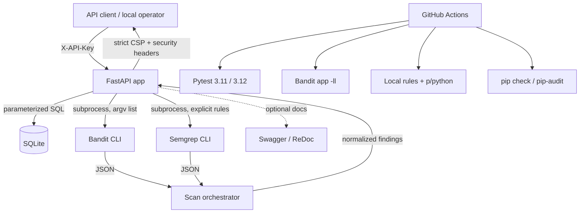
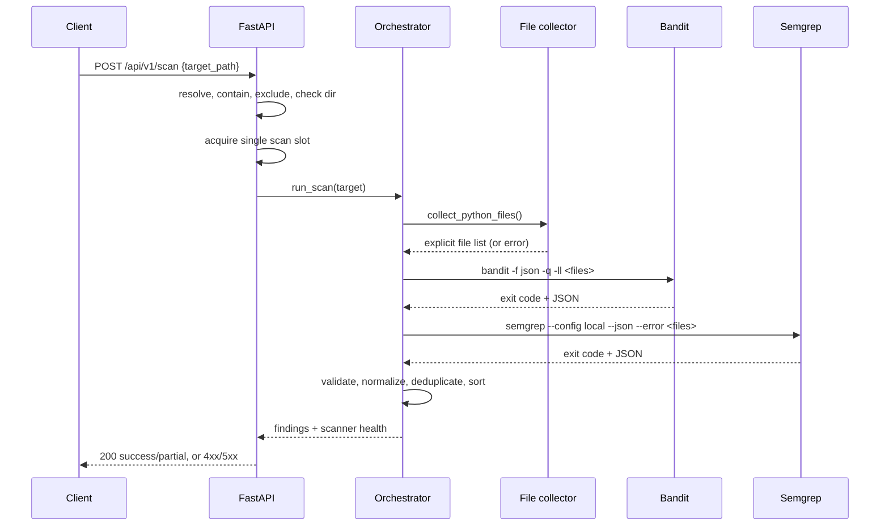
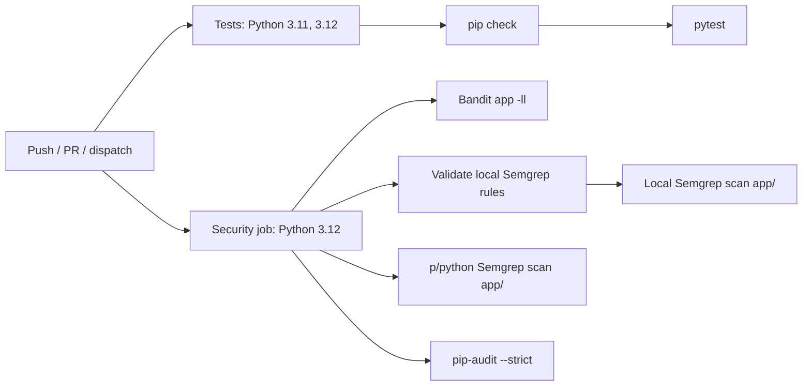

# Secure Code Review Tool — Architecture

## 1. System Context

## 2. Components

### FastAPI application (`app/main.py`)

- Reads configuration at startup: `LAB_API_KEY`, `LAB_DB_PATH`, `LAB_SCAN_ROOT`, and `LAB_ENABLE_DOCS`. `LAB_MAX_SCAN_FILES` is read when a scan starts so the limit can be changed without importing the module again.
- Serves health, item, demo, and scan routes.
- Requires `X-API-Key` on every route except `/health` and, when enabled, documentation.
- Fails closed when `LAB_API_KEY` is empty.
- Resolves and contains scan targets under `LAB_SCAN_ROOT`.
- Uses a single `threading.BoundedSemaphore` slot to reject concurrent scans with 429.
- Returns 503 when both scanners fail and 400 for rejected targets.

### HTTP security middleware (`app/middleware.py`)

Adds headers to every response:

- `Content-Security-Policy` — strict API policy (`default-src 'none'`) by default; a documentation-only policy is used for `/docs`, `/redoc`, and the OAuth redirect path when docs are enabled.
- `Strict-Transport-Security`, `X-Content-Type-Options`, `X-Frame-Options`, `X-XSS-Protection: 0`, `Referrer-Policy`, `Cache-Control: no-store`, `Permissions-Policy`, COOP, CORP, and `X-Permitted-Cross-Domain-Policies`.
- API responses are never cached by this layer.

### Database access

SQLite is opened per request with a 10-second timeout. The `items` table is created if absent. Item creation, lookup, and search use bound parameters. Search escapes `%`, `_`, and the escape character before building a `LIKE` pattern, so user input is matched literally.

### Scanner layer (`app/scanner/`)

Key properties:

- **Explicit file arguments.** The orchestrator enumerates Python files itself rather than passing a directory, so virtual environments, caches, and excluded directories cannot silently enlarge the scan.
- **No shell.** Scanners run through `subprocess.run` with an argument list, `shell=False`, a timeout, and captured output.
- **Containment.** Directory symlinks are not followed; file symlinks are resolved and kept only when they remain inside the scan root and outside excluded directories. Dot-directories and excluded names are skipped.
- **Bounded work.** `LAB_MAX_SCAN_FILES` caps the file list. The API admits one scan at a time per process.
- **Explicit Semgrep configuration.** The scanner uses `.semgrep/rules.yml` with metrics disabled. It never uses `--config auto`, which is incompatible with metrics-off operation.
- **Strict interpretation.** Non-JSON output, empty output, scanner errors, invalid rules, timeouts, and unexpected exit codes are treated as scanner failures. Findings (exit 1) are not.
- **Honest status.** Both scanners succeeding yields `success`; one yields `partial`; neither yields `error` and HTTP 503.

### Reporting utilities (`app/services/report_service.py`)

The service can serialize scan results to JSON and to SARIF 2.1.0 with GitHub code-scanning fields. It is currently a library used by tests; no HTTP export route is exposed. SARIF output must still be reviewed before upload.

### CI workflow (`.github/workflows/ci.yml`)

A single workflow named `Secure Code Review CI` runs on push to `main`, pull requests to `main`, and manual dispatch.

- `permissions: contents: read`; checkout does not persist credentials.
- Third-party actions are pinned to full commit SHAs.
- `concurrency` cancels superseded runs for the same ref.
- `app/` is the blocking scanner target. Fixtures are validated by tests instead.
- No `continue-on-error` and no ignored scanner failures.

## 3. Trust Boundaries

| Boundary | Control |
| --- | --- |
| Client → API | Shared API key, request validation, bounded input lengths, generic error messages. |
| API → filesystem | Resolved scan root, containment check, excluded directories, symlink checks, file cap, single scan slot. |
| API → scanner subprocess | Fixed executables/argument lists, no shell, timeouts, JSON parsing, stable error codes. |
| API → SQLite | Parameter binding, literal LIKE escaping, positive-ID validation. |
| Container → host | Non-root user, read-only root filesystem, dropped capabilities, no-new-privileges, localhost-only published port. |
| CI → repository | Read-only token, SHA-pinned actions, no secrets in scanner jobs, no `pull_request_target`. |

The scan endpoint is **not** a sandbox. It runs trusted scanner binaries against files the application user can read. The scan root, exclusions, and API key reduce exposure but do not replace process isolation, a dedicated low-privilege account, or container/VM separation.

## 4. Failure and Response Model

| Condition | Scanner API result | HTTP |
| --- | --- | --- |
| Both scanners complete | `success`, `completed` | 200 |
| One scanner completes | `partial`, `completed_with_warnings` | 200 |
| Both scanners fail | `error`, `failed`, `all_scanners_failed` | 503 |
| Target escapes root | `error`, `invalid_target` | 400 |
| Target excluded | `error`, `excluded_target` | 400 |
| File cap exceeded | `error`, `target_too_large` | 400 |
| Target unreadable | `error`, `target_unreadable` | 400 |
| Scan already running | not run | 429 |
| Unexpected orchestrator exception | logged server-side | 500 |

## 5. Deployment Notes

- The default configuration binds to `127.0.0.1` in examples and Compose.
- Interactive documentation is disabled by default; enable it only for local use.
- The application does not terminate TLS. Put it behind a trusted reverse proxy if network access is required.
- The shared API key is not a user identity, role, or tenant boundary.
- SQLite is suitable for this lab, not for concurrent multi-instance production use.
- The container runs as a non-root user with a read-only root filesystem and a writable data volume.
- Keep reports and evidence out of the image; only `app/` and `.semgrep/` are copied.

## 6. Residual Risk

- Pattern-based scanners can miss vulnerable data flows and flag safe code.
- The maintained local rules cover eight classes; they are not a complete Python security ruleset.
- `p/python` is a community ruleset whose coverage and false-positive rate vary by revision.
- No distributed rate limiting, audit log, per-user authorization, secrets manager, or incident-response process is implemented.
- Dependency audit results reflect the advisory database at scan time.
- Container hardening is a baseline, not a production security certification.

See [`docs/security-policy.md`](security-policy.md) for the enforcement and triage rules.
